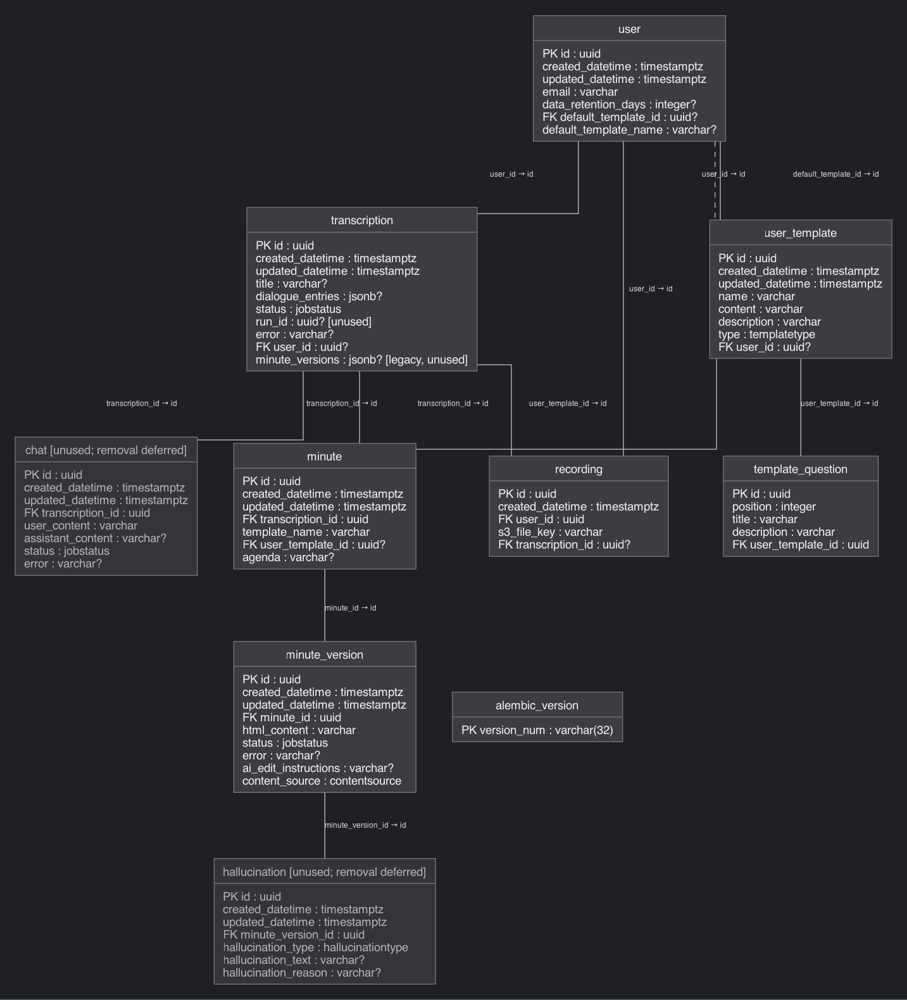

[](https://github.com/i-dot-ai/minute/actions/workflows/checks.yml?query=branch%3Amain)

# Minute

> [!IMPORTANT]
> Incubation Project: This project is in active development and a work in progress.

Minute is an application that is designed to simplify the transcription and minuting of meetings in the public sector. Built with modern web technologies and AI-powered transcription and summarisation services, Minute transforms how government organisations handle meeting documentation by automating the conversion of audio recordings into structured, professional minutes.

## Key Features

**AI-Powered Transcription**: Minute integrates with multiple transcription services including Azure Speech-to-Text and AWS Transcribe, automatically selecting the most appropriate service based on audio duration and quality. The system handles various audio formats and automatically converts them to optimize transcription accuracy.

**Professional Meeting Templates**: The application includes specialized templates tailored for different types of government meetings, including Cabinet meetings, planning committees, care assessments, and general-purpose meetings. Each template follows specific formatting standards and style guides required for official documentation.

**Intelligent Minute Generation**: Beyond simple transcription, Minute uses AI to structure conversations into professional minute formats, applying proper grammar, tense conversion, and formatting rules specific to government documentation standards.

**Multi-Format Audio Support**: Upload recordings in various formats - the system automatically handles conversion and optimization for the best transcription results. Support for mono and multi-channel audio ensures compatibility with different recording setups.

**Data Retention**: Configurable data retention policies ensure compliance with government data handling requirements, with special provisions for different departments' retention policies.

**Real-Time Processing**: Asynchronous processing architecture ensures efficient handling of large audio files, with job status tracking and progress monitoring throughout the transcription and minute generation process.

Minute streamlines the traditionally time-intensive process of creating meeting minutes, allowing public sector organizations to focus on decision-making rather than documentation overhead.

## Development

#### Run the app locally

Prerequisites: Docker with Compose v2 and `make`. Run from this repository's root:

```sh
cp .env.example .env  # first setup only; keep an existing .env
mkdir -p .data
```

Edit `.env`, keeping `ENVIRONMENT=local` and the dummy AWS credentials. For the default processing
providers, configure `AZURE_SPEECH_KEY`, `AZURE_SPEECH_REGION`, `GOOGLE_CLOUD_PROJECT`,
`GOOGLE_CLOUD_LOCATION` and `GOOGLE_APPLICATION_CREDENTIALS_BASE64` (your service-account JSON
encoded as a single-line base64 value). Clear unused Azure fallback key/region pairs and leave
`SENTRY_DSN` and `POSTHOG_API_KEY` empty if you do not want telemetry.

```sh
make run
```

This builds and starts the stack at the pinned Temporal version, runs application database
migrations and bootstraps Temporal. The namespace task automatically registers the
[local Temporal search attributes](#local-temporal-search-attributes) before backend/worker startup.
The `.data/` directory must be writable by the backend and worker containers (UID 1000).
Python, Node.js and `uv` do not need to be installed on the host for the Compose stack.

The stack includes the frontend at http://localhost:3000, backend at http://localhost:8080,
application worker, PostgreSQL on port 5432, MiniStack on port 4566, and Temporal on port 7233
with its UI at http://localhost:8233. One-off services bootstrap Temporal's databases and namespace.

No infrastructure repository or real AWS account is needed. MiniStack emulates local AWS services;
it does **not** emulate Azure transcription or Gemini summarisation. Processing recordings requires
your own provider credentials; the non-paid test suite and mocked frontend tests do not.
Local mode uses a dummy user; no hosted login or Auth API credentials are required.

#### Local Temporal search attributes

`temporal-namespace` creates the `default` namespace when needed and automatically registers
`UserId`, `TranscriptionId`, `MinuteId` and `MinuteVersionId` as `Keyword`. Registration retries
briefly during cold startup; persistent failure prevents backend/worker startup. Matching existing
attributes are left unchanged. A conflicting type fails bootstrap rather than being overwritten.

To verify registrations against the running Compose server:

```sh
docker compose exec temporal temporal operator search-attribute list \
  --address localhost:7233 --namespace default --output json
```

For an existing stack using an older admin image, run `make run` to build/start the updated
bootstrap. Investigate type conflicts rather than deleting registrations used by existing workflows.

#### Set up your development environment:

Use Compose watch to sync local edits into the development containers:

`make run_watch`

This syncs local file changes and restarts services as configured in `docker-compose.yaml`.
Use `docker compose logs -f backend worker frontend` for logs and `make stop` to stop the stack.
Stopping preserves database volumes; `docker compose down -v` deletes local volume data.

#### Networks that inspect HTTPS traffic

If your network intercepts outbound HTTPS (TLS inspection), the containers may fail to verify certificates and log `CERTIFICATE_VERIFY_FAILED` errors. To fix this, provide the containers with a CA bundle that includes your network's root certificate via a local, untracked `docker-compose.override.yaml` (Compose merges it automatically):

```yaml
services:
  backend: &ca
    volumes:
      - ./certs/host-ca-bundle.pem:/etc/ssl/certs/host-ca-bundle.pem:ro
    environment:
      - REQUESTS_CA_BUNDLE=/etc/ssl/certs/host-ca-bundle.pem
      - SSL_CERT_FILE=/etc/ssl/certs/host-ca-bundle.pem
      - AWS_CA_BUNDLE=/etc/ssl/certs/host-ca-bundle.pem
      - GRPC_DEFAULT_SSL_ROOTS_FILE_PATH=/etc/ssl/certs/host-ca-bundle.pem
  worker: *ca
  frontend:
    volumes:
      - ./certs/host-ca-bundle.pem:/etc/ssl/certs/host-ca-bundle.pem:ro
    environment:
      - NODE_EXTRA_CA_CERTS=/etc/ssl/certs/host-ca-bundle.pem
```

Place your CA bundle at `certs/host-ca-bundle.pem`. On macOS you can export your machine's trusted roots with:

```sh
security find-certificate -a -p /System/Library/Keychains/SystemRootCertificates.keychain > certs/host-ca-bundle.pem
security find-certificate -a -p /Library/Keychains/System.keychain >> certs/host-ca-bundle.pem
```

`docker-compose.override.yaml` and `certs/` are gitignored, so this stays local to your machine.

## Project structure

#### `frontend/`

The frontend uses Next.js. Calls to the API are made from the client-side and proxied api using Next's middleware. All API calling code is auto-generated by [Hey API](https://heyapi.dev/), the config for this can be found in `frontend/openapi-ts.config.ts`. It uses the api running locally to get the openapi.json, so to regenerate the types run the docker compose, and then run `npm run openapi-ts` in `frontend/`.

#### `backend/`

The backend uses FastAPI to manage meeting data and start processing workflows in Temporal.

#### `worker/`

The worker runs the tasks coordinated by Temporal: audio conversion, transcription and AI-generated minutes. Results are saved in the database.

## Architecture

The frontend calls the FastAPI backend, which stores meetings and minutes in PostgreSQL and starts
Temporal workflows. Workers convert audio, call the configured transcription/LLM providers, and
save results. Storage can use local files or S3; uploaded audio is authorised by the backend.

This repository contains application source, local tooling and lint/test workflows only. Builds,
image publication, hosted deployments and operational runbooks are maintained separately by operators.

#### Database schema



#### Sentry setup (optional)

To set up sentry for telemetry, create an account at [sentry.io](https://sentry.io).

- Navigate to the `projects` page
- Click `Create project`
- Select `FASTAPI` as project type
- Click create
- On the following page, in the `Configure SDK`, copy the value for `dsn=` **KEEP THIS SECRET**
- Set `SENTRY_DSN` in your local `.env`; leave it empty to disable telemetry.

#### Posthog setup (optional)

To set up posthog for UX tracking, feature flags etc, create an account at [eu.posthog.com](https://eu.posthog.com/).

- create a project and obtain an API key (it should start `phc_`)
- set the key `POSTHOG_API_KEY` value in your `.env`

#### Linear support tickets (optional)

The in-app support page falls back to email when `LINEAR_API_KEY` or `LINEAR_TEAM_ID` is empty.
To test ticket submission locally, configure your own Linear API key and team ID in `.env`.
`LINEAR_PROJECT_ID` and the four `LINEAR_LABEL_ID_*` values are optional routing settings.
Submitting a ticket creates a real Linear issue containing the message and local user's details;
leave these settings empty unless you intend to use that service. Never commit API keys.
The static public support page remains email-only.

## Testing

To run unit tests:

```bash
make test
```

Start the local dependencies with `docker compose up -d --wait db ministack`, then run
`uv run alembic upgrade head` before the first test run. The real-file duration test is skipped
when ffprobe is unavailable; install ffmpeg locally to run it and optional audio-fixture tests.

### Testing paid APIs and LLM prompt evaluations

A special set of tests are available to evaluate paid calls to LLM providers. Since we don't want to run this all the
time, we enable these with:

```bash
ALLOW_TESTS_TO_ACCESS_PAID_APIS=1
```

is in your `.env` file.

Some paid tests require local audio/transcript fixtures under `.data/`. These files and provider
credentials are not committed. The real-backend upload test requires the local stack started with
`make run`, including successful Temporal namespace/search-attribute bootstrap.

## Adding custom templates

You can add your own templates by implementing either the `SimpleTemplate` or `SectionTemplate` protocols (see [here](common/templates/types.py)).
Add them under [common/templates](common/templates) and register them in `TemplateManager`.
