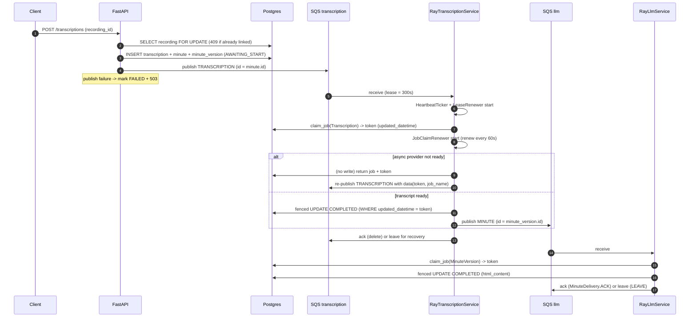

# FYI — Architecture, Flow, and the Claim/Token System

Audience: engineers working on the worker/queue pipeline. This is the "how it works
today" note, not a spec. Keep it updated when the flow changes.

## 1. Overview

The API writes job rows to Postgres and publishes a small `WorkerMessage` to SQS. Ray
actors in the worker container consume messages, do the slow work (transcription, LLM),
and write results back to Postgres. Correctness under at-least-once delivery, retries,
crashes, and actor restarts is provided by:

- **atomic job claims** + **fencing tokens** on the DB rows,
- **renewed claims** (DB) and **renewed SQS visibility leases** while a task runs,
- a **heartbeat watchdog** that restarts wedged actors,
- **terminal-only acknowledgement** of queue messages.

There is no outbox table and no extra claim columns — everything reuses `status` and
`updated_datetime`.

## 2. Components

| Component | File | Role |
|---|---|---|
| API routes | `backend/api/routes/{transcriptions,minutes}.py` | Validate/authorise, create rows, enqueue work |
| Queue service | `common/services/queue_services/sqs.py` | SQS publish/receive/ack/deadletter + visibility renewal |
| Transcription handler | `common/services/transcription_handler_service.py` | Claim, run provider, complete/fail, reconcile duplicates |
| Minute handler | `common/services/minute_handler_service.py` | Claim, generate/edit minutes, complete/fail |
| Job claim | `common/services/job_claim.py` | `claim_job`, `refresh_job`, `JobClaimRenewer` |
| SQS lease renewer | `worker/lease_renewer.py` | `LeaseRenewer` extends message visibility |
| Actors | `worker/ray_receive_service.py` | `RayTranscriptionService`, `RayLlmService` |
| Supervisor | `worker/worker_service.py` | Starts/supervises actors, restarts wedged ones |
| Healthcheck | `worker/healthcheck.py` | `HeartbeatTicker` + container healthcheck script |

Queues: `TRANSCRIPTION_QUEUE_NAME` (`TaskType.TRANSCRIPTION`) and `LLM_QUEUE_NAME`
(`TaskType.MINUTE`, `TaskType.EDIT`), each with a dead-letter queue
(`maxReceiveCount = 4`).

## 3. End-to-end data flow



`TaskType` is ordered (TRANSCRIPTION=1, MINUTE=2, EDIT=3) so the queue order matches the
logical pipeline order.

## 4. Statuses and message types

- `JobStatus`: `AWAITING_START → IN_PROGRESS → COMPLETED | FAILED`.
- `WorkerMessage`: `{id, type, data}`; `id` is a **minute id** for TRANSCRIPTION and a
  **minute_version id** for MINUTE/EDIT.
- `TranscriptionJobMessageData`: provider name, `job_name`, optional `transcript`, and
  `claim_token` (fencing token carried across async poll deliveries).
- `EditMessageData`: `source_id` (an AI-edit source minute version).

## 5. The claim / token system (the important bit)

Ownership of a job is a **lease** on the DB row, expressed as `status` + the row's
`updated_datetime`. The token is simply `updated_datetime` at claim time.

### Claim

`claim_job(model, job_id) -> datetime | None` (`job_claim.py`):

```sql
UPDATE <model> SET status = 'IN_PROGRESS'
WHERE id = :id
  AND (status = 'AWAITING_START'
       OR (status = 'IN_PROGRESS' AND updated_datetime < now() - CLAIM_STALE_AFTER));
-- returns the new updated_datetime (the token), or None if the row was not claimable
```

`updated_datetime` has `onupdate=now()` (`postgres_models.py`), so the claim write
rotates the token. The "OR stale" branch is **reclaim**: a claim older than
`CLAIM_STALE_AFTER` is treated as abandoned (its worker died).

### Renew

`refresh_job(model, job_id, token) -> datetime | None`:

```sql
UPDATE <model> SET status = 'IN_PROGRESS'
WHERE id = :id AND status = 'IN_PROGRESS' AND updated_datetime = :token;
```

It writes `status` only to advance `updated_datetime`, producing a fresh token.
`JobClaimRenewer` calls this every 60s in a short `to_thread` transaction — **no DB
connection is held during the provider/LLM call** (this replaced an earlier
advisory-lock design that pinned a connection for the whole task).

### Fence writes

`update_transcription` / `update_minute_version` take a required `claim_token`:

```sql
UPDATE <model> SET ... WHERE id = :id AND updated_datetime = :token;
-- rowcount == 1  => still owned (applied)
-- rowcount == 0  => superseded (dropped)
```

A worker whose claim was reclaimed cannot clobber the new owner's result.

### Why it works without a migration

- Reuses existing `status` + `updated_datetime` (no new columns, no migration).
- `onupdate=now()` is what makes the token rotate — **removing that `onupdate` breaks
  claims and renewal**.

### Invariants / caveats

- Any write to the row rotates `updated_datetime` and therefore invalidates the token.
  Keep claim/fence writes the only writers while a job is `IN_PROGRESS`.
- `CLAIM_STALE_AFTER` (3 min) must exceed how long a *dead* worker takes to be considered
  gone, and stay below the SQS visibility window so the first redelivery can reclaim.
- Async poll chains carry the token in the message so poll completions are fenced too.

## 6. Queue lease + recovery semantics

- **SQS visibility** is 300s. `LeaseRenewer` calls `extend_message_lease` every 100s
  while the task runs, so a long task is not redelivered; renewal stops on completion,
  invalid receipt, or owner exit.
- **Ack only when terminal.** A duplicate delivery that finds the job owned by a live
  worker is left unacknowledged (`LEAVE`) so recovery stays possible; a terminal job is
  acknowledged (`ACK`). See `DuplicateDelivery` / `MinuteDelivery`.
- **Crash recovery.** If a worker dies, its visibility lease lapses → redelivery →
  `claim_job` reclaims the stale claim → the job re-runs.
- **Lost minute publish.** A `COMPLETED` transcription whose minute message never landed
  is healed on redelivery (`REPUBLISH_MINUTE`).
- **Handled failures** write `FAILED` (fenced) and ack the message; the user retries via
  `POST /transcriptions/{id}/retry` (atomic `FAILED → AWAITING_START`).
- **Enqueue failure at the API** marks the row `FAILED` and returns `503` (retryable).
- **Stalled-job reaper.** Every 5 minutes, `reap_stalled_records` marks `IN_PROGRESS`
  rows untouched for 15 minutes (their delivery is gone, e.g. dead-lettered) and
  `AWAITING_START` rows older than 1 day as `FAILED`. This turns a dead-lettered job into
  a retryable `FAILED` row without waiting for the next daily retention cleanup.

## 7. Actor health and supervision

- Each actor writes `worker_<actor_id>.heartbeat`; `HeartbeatTicker` touches it every 15s
  while its event loop runs.
- `HEARTBEAT_TIMEOUT = 60s`. `WorkerService` scans every 15s and, for a stale actor,
  `ray.kill`s it and installs a fresh actor handle; the killed actor's failed future is
  what triggers the single `process()` re-submission (one submitter).
- Container healthcheck (`worker/healthcheck.py`) runs every 30s with 2 retries; it fails
  if any heartbeat is stale or if fewer workers report than `MAX_TRANSCRIPTION_PROCESSES +
  MAX_LLM_PROCESSES`.
- A genuinely blocked event loop starves the ticker too, so wedges are still detected.

## 8. Timing constants

| Mechanism | Value | Source |
|---|---|---|
| Heartbeat tick | 15s | `worker/healthcheck.py` |
| Actor stale threshold | 60s | `worker/healthcheck.py` |
| Supervisor scan | 15s | `worker/worker_service.py` |
| Container healthcheck | 30s × 2 retries | `docker-compose.yaml`, `terraform/ecs.tf` |
| DB claim stale / reclaim | 3 min | `common/settings.py` (`CLAIM_STALE_AFTER`) |
| DB claim renewal | 60s | `common/services/job_claim.py` |
| SQS visibility timeout | 300s | `common/services/queue_services/sqs.py` |
| SQS lease renewal | 100s | `worker/lease_renewer.py` |

## 9. Running things

- Tests (needs the docker-compose stack: `make run`):
  `ALLOW_TESTS_TO_ACCESS_PAID_APIS=0 uv run pytest tests/`
- Lint/format: `uv run ruff check . && uv run ruff format --check .`
- Pre-commit: `uv run pre-commit run --all-files`
