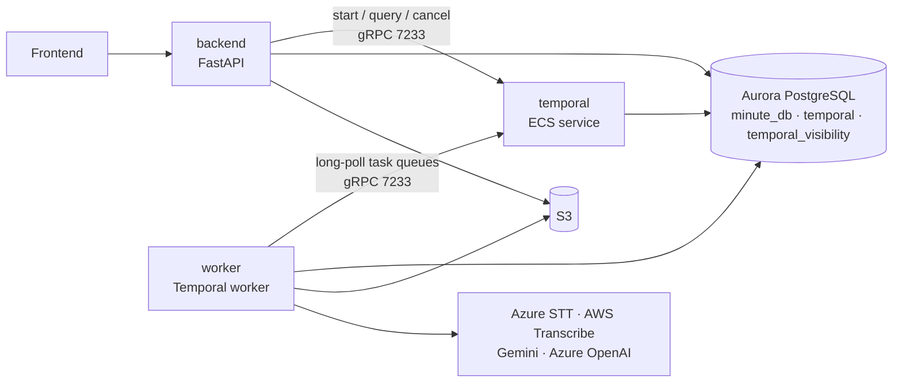
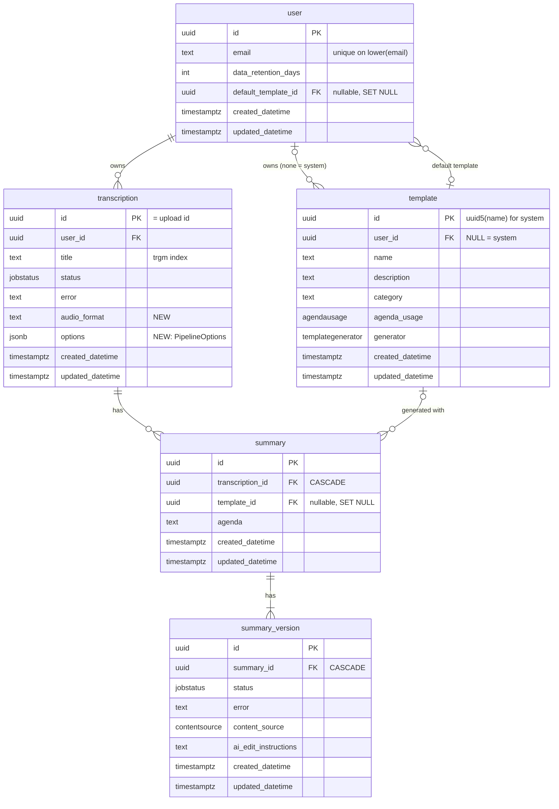

# Architecture Proposal: Backend & Worker v2

**Status:** proposal, target state only (migration planning is a follow-up exercise)
**Scope:** `backend/`, `worker/`, `common/`, `terraform/`. Frontend unchanged except
where the API shape changes (see §11).
**Orchestrator:** self-hosted [Temporal](https://temporal.io) (MIT) on the
existing Aurora PostgreSQL cluster. §10.3 explains why it was chosen over the
alternatives.

---

## 1. Requirement recap

The proposal must:

1. **Prefer storage over database.** Large content (audio, transcripts, minutes,
   templates) lives in S3 keyed by id; Postgres keeps only small, queryable
   metadata.
2. **Make components optional.** Speaker naming, title generation and minute
   generation (summarisation) can be switched off per run. Only transcription is
   mandatory.
3. **Abstract every external service behind Prototypes (Protocols).** Storage,
   database, transcription provider, and one LLM protocol per component are
   injectable Python `typing.Protocol` interfaces with swappable
   implementations.
4. **Use workflows as the high-level worker flow**, so each run is trackable,
   monitorable and observable as a first-class record (per-step status, errors,
   timings, retries) rather than being implicit in message chaining.
5. **Use the repository pattern** for all database and object-store queries, so
   domain logic never touches SQLAlchemy sessions or boto3 directly.
6. **Use queues to distribute load** across workers.
7. **Make runs idempotent**: no duplicated work, no orphan jobs or files.

---

## 2. Where the current architecture leaks

The gaps below are concrete, so the improvement section (§10) can be checked
against them.

| # | Gap | Where today |
|---|-----|-------------|
| G1 | **Zombie jobs.** "Commit, then publish" has a crash window: rows reach `AWAITING_START` but the SQS message is never published. Nothing re-publishes for a stranded row except daily cleanup marking it `FAILED`. | `backend/api/routes/transcriptions.py:65-74`, `backend/api/routes/minutes.py:32-41` |
| G2 | **Orphan artefacts.** The mono-convert step uploads a *new* MP3 under a new uuid key and inserts a *new* `Recording` row mid-pipeline; a crash between the two leaves an S3 object that no column points to. | `common/services/transcription_services/transcription_manager.py:100-128` |
| G3 | **S3 outlives Postgres.** Retention cleanup deletes rows but not the audio/transcript objects behind them; provider output cleanup is best-effort in handlers. | `backend/cleanup_job.py` |
| G4 | **Content in the database.** Full transcripts as JSONB, minutes as HTML text, template bodies. This pushes RDS size/IO up and makes retention surgery harder. | `common/database/postgres_models.py` (`dialogue_entries` on `Transcription`, `html_content` on `MinuteVersion`, `content` on `UserTemplate`) |
| G5 | **PII in S3 keys.** Upload keys embed the user's email. | `backend/utils/get_file_s3_key.py` |
| G6 | **Silent failures in audio probing.** ffprobe failures return magic values (2 channels, 14400 s) which force pointless re-encodes and silently degrade provider selection. | `common/audio/ffmpeg.py:75-85, 109-122` |
| G7 | **Swallowed LLM failure.** Title generation has a bare `except:` that hides real provider errors behind an empty title. | `common/generate_meeting_title.py:19` |
| G8 | **Provider poll state lives in queue messages.** Async transcription re-publishes a message carrying the job name *and the fencing token*; message data is state, not just work. | `common/types.py:184-198`, `worker/ray_receive_service.py:88-93` |
| G9 | **Supervision duplicated from ECS.** Ray actors + a hand-written actor supervisor + per-actor heartbeat scanner reinvent "container dies → ECS restarts it". | `worker/worker_service.py`, `worker/ray_receive_service.py`, `worker/healthcheck.py` |
| G10 | **Pipeline is implicit.** `TaskType` ordering plus ad-hoc `REPUBLISH_MINUTE` healing messages stand in for a workflow; the only audit trail is statuses spread across three tables. | `common/types.py:173-177`, `worker/ray_receive_service.py:100-119` |
| G11 | **Components are not separable.** Speaker naming and title generation run *inside* the transcription handler; turning one off is not an option at run level. | `common/services/transcription_handler_service.py:216-224` |
| G12 | **Hand-rolled durability.** Claims, fencing tokens, claim renewal, SQS lease renewal, duplicate-delivery reconciliation and a reaper (documented in FYI.md but never implemented) together reimplement what a workflow engine provides. | `common/services/job_claim.py`, `worker/lease_renewer.py`, `FYI.md` §5–§6 |

---

## 3. Target architecture at a glance



Four services, one database cluster, one bucket:

* **backend** (unchanged role): validates and authorises requests, writes
  metadata rows, then *starts* a workflow by calling Temporal.
* **temporal** (new): an ECS service running the stock `temporalio/server` image.
  It persists every workflow's history in Postgres, holds the task queues,
  dispatches work, retries failed activities, and detects dead workers.
* **worker** (rewritten): a plain Python process running a `temporalio`
  `Worker`. It executes workflow code and activities. Ray is deleted.
* **Aurora PostgreSQL** (existing cluster): our `minute_db` plus two new
  databases owned by Temporal, `temporal` and `temporal_visibility`.

Code layout. Dependencies only point downward:

```
backend/api/ · worker/main.py            entry points: build a Runtime, call down
common/workflows/                        workflow definitions (deterministic orchestration only)
common/domains/<domain>/                 entities, repository, activities
    transcriptions/ summaries/ templates/ users/
common/providers/                        Protocols + adapters for external systems
    storage/ transcription/ llm/
```

* **Workflows** decide *what* runs and in which order. They never do I/O.
* **Activities** do all the I/O, and live next to the repository and domain
  they act on.
* **Repositories** are the only code that talks to Postgres or S3.
* **Providers** are the only code that imports boto3, the Azure/Gemini/OpenAI
  SDKs, or ffmpeg.

---

## 4. Storage layout: S3 first, database second

### 4.1 Key layout: deterministic, ids only, no pointer columns

Every blob is keyed by the id of the DB row it belongs to, so code never stores
a content key. It **derives** the key. Everything a transcription produces sits
under one prefix:

```python
# common/domains/content_keys.py
def audio_key(transcription_id: UUID, artefact: str = "original") -> str:
    return f"transcriptions/{transcription_id}/audio/{artefact}"           # original, converted.mp3

def transcript_key(transcription_id: UUID, variant: str = "raw") -> str:
    return f"transcriptions/{transcription_id}/transcript/{variant}.json"  # raw, named

def summary_key(transcription_id: UUID, version_id: UUID) -> str:
    return f"transcriptions/{transcription_id}/summaries/{version_id}.html"

def template_key(template_id: UUID) -> str:
    return f"templates/{template_id}.json"
```

Consequences (all deliberate):

* **No `s3_file_key`-style columns and no `recording` table.** Audio is an
  artefact of its transcription, like the transcript (§4.2).
* **Deleting a transcription is one prefix delete** (`transcriptions/{id}/`),
  which removes the audio, transcripts and every summary version. This fixes G3.
* **No orphanable second recording row.** The converted MP3 is written to
  `audio/converted.mp3` and a retry overwrites the same key (G2).
* **No PII in keys** (G5). Ownership lives in Postgres and is enforced by the
  API.
* **Idempotent writes for free.** Every activity writes to a key that depends
  only on its inputs, so a retried activity overwrites its own earlier attempt
  rather than creating a second object (§9).

### 4.2 Uploads without a recording row

Today `POST /recordings` inserts a `recording` row before any transcription
exists, only so the upload has an id to hang off. In v2 **the upload's id is
the transcription id**:

1. `POST /uploads {file_extension}`: the API generates a `transcription_id` and
   returns it with a presigned PUT for `audio_key(id)`. No row is written. The
   presigned URL signs `x-amz-meta-user-id` and `x-amz-meta-extension`, so the
   client can't upload without them or change them.
2. The client uploads the audio.
3. `POST /transcriptions {id, …}`: the API `HEAD`s the object, returns 404
   unless its `user-id` matches the caller, inserts the `transcription` row
   with that id (copying the extension to `audio_format`), and starts the
   workflow (§7.5).

What this replaces:

* **Double submit:** the second insert hits the primary key and returns 409.
  This replaces the `FOR UPDATE` lock and the "already transcribed" check
  (`transcriptions.py:180-188`).
* **Abandoned uploads** leave an object with no row. `RetentionWorkflow` already
  deletes `transcriptions/` prefixes with no owning row. It only touches
  prefixes older than a day, so uploads in progress are safe. This replaces
  `delete_orphan_records()` in `cleanup_job.py`.
  <!-- ponytail: daily listing of transcriptions/ to find orphans; switch to
  an S3 lifecycle rule on an upload tag (removed on submit) if listing gets slow -->
* **Downloads:** `GET /transcriptions/{id}/recordings` lists `audio/` under the
  prefix and returns presigned GETs named `{title}.{audio_format}` (original)
  and `{title}.mp3` (converted). The response shape is unchanged.

### 4.3 Templates: one table for system and user templates

Today system templates are Python classes looked up by `minute.template_name`,
and user templates are rows looked up by `minute.user_template_id`. Every
consumer handles both: create, retry, the user's default, generation dispatch
(`minute_handler_service.py:259-268`) and the frontend's merged list. In v2
**both are rows in one `template` table, with the body in S3**:

* **System templates** have `user_id NULL` and a fixed id
  (`uuid5(TEMPLATE_NS, name)`). They are seeded on every deploy from
  `common/templates/default/` by an idempotent upsert of the row and
  `templates/{id}.json`. The API refuses edits and deletes when
  `user_id IS NULL`.
* **One reference everywhere.** `summary.template_id` and
  `user.default_template_id` are single foreign keys. `template_name`,
  `user_template_id` and `default_template_name` are dropped. `GET /templates`
  returns one list, and `/user-templates` folds into it.
* **`templates/{id}.json` holds everything generation needs:** prompt or body,
  questions (form templates), temperature, the citations flag and section
  config. Prompts become `str.format` strings with `{transcript}` and
  `{agenda}` placeholders.
* **`generator` picks the code path**, replacing `type`. Generators are code in
  `common/templates/generators/`; templates are data:

  | `generator` | Behaviour | Used by |
  |---|---|---|
  | `document` | one prompt, one call | user document templates, General, Short 'n' Sweet, Care Assessment V2 |
  | `form` | one call per question, each seeing earlier answers | user form templates |
  | `sections` | one call per section; sections from the agenda, or from an LLM step when there is none | Planning Committee, Cabinet |
  | `delivery` | structured output + Python assembly | Delivery |

  Users can only create `document` and `form` templates.
* **The list view's metadata stays in the row:** name, description, category,
  agenda_usage. `BETA_TEMPLATE_NAMES` keeps filtering by name.

### 4.4 What lives where

| Content | S3 (by id) | Postgres `minute_db` (small, queryable) |
|---|---|---|
| Audio original + converted | `transcriptions/{id}/audio/…` | `transcription`: audio_format |
| Transcript (`DialogueEntry` list) | `transcriptions/{id}/transcript/raw.json`, `named.json` | `transcription`: title (trgm-indexed), status, error, user_id, options |
| Summaries and their versions | `transcriptions/{id}/summaries/{version_id}.html` | `summary`: template_id, agenda; `summary_version`: status, error, content_source, ai_edit_instructions |
| Templates (system and user) | `templates/{id}.json` | `template`: user_id (NULL = system), name, description, category, agenda_usage, generator |
| Workflow history, task queues | — | Temporal's own `temporal` / `temporal_visibility` databases |

The big tables lose their blob columns (`dialogue_entries`, `html_content`,
`content`), and the `recording` and `template_question` tables go. **No
workflow tables are added to `minute_db`**: orchestration state is Temporal's
job and stays in Temporal's databases.

**Temporal stores only identifiers.** Workflow and activity inputs and outputs
are ids, S3 keys and small enums, never transcripts or summaries. Temporal
records every payload in its history, so this rule keeps meeting content out of
Temporal's tables and keeps one source of truth for content (S3). It is
enforced by convention, and checked in review and in tests (§8.6).

### 4.5 Database schemas

The cluster holds three databases:

| Database | Owner | Schema managed by |
|---|---|---|
| `minute_db` | us | Alembic, as today |
| `temporal` | Temporal server | `temporal-sql-tool` (§8.4); never edited by hand |
| `temporal_visibility` | Temporal server | `temporal-sql-tool` (§8.4); never edited by hand |

Our code never reads Temporal's two databases directly. It goes through the
Temporal client (`describe()`, visibility queries) only.

**`minute_db` ERD (target).** Content lives in S3 under id-derived keys (§4.1),
so it doesn't appear here.



Rows link to Temporal only through the workflow id, which is built from the
row's own id (`transcription-{id}`, `summary-version-{id}`, §7.1). There is no
foreign key or stored run id.

**`minute_db` target schema.** These are the changes from
`common/database/postgres_models.py`. Each table's other columns, foreign keys
and indexes stay as they are. The DDL is for reading only: the tables are in
reading order, not dependency order, and Alembic generates the real migration.

```sql
-- IN_PROGRESS is no longer written to rows (§7.4), but stays in the type
-- because the API still returns it and Postgres can't drop enum values cleanly.
CREATE TYPE jobstatus         AS ENUM ('AWAITING_START', 'IN_PROGRESS', 'COMPLETED', 'FAILED');
CREATE TYPE contentsource     AS ENUM ('MANUAL_EDIT', 'AI_EDIT', 'INITIAL_GENERATION');
CREATE TYPE agendausage       AS ENUM ('NOT_USED', 'OPTIONAL', 'REQUIRED');      -- NEW: was Python-only
CREATE TYPE templategenerator AS ENUM ('DOCUMENT', 'FORM', 'SECTIONS', 'DELIVERY'); -- NEW: replaces templatetype

CREATE TABLE "user" (
    id                  uuid PRIMARY KEY DEFAULT gen_random_uuid(),
    created_datetime    timestamptz NOT NULL DEFAULT now(),
    updated_datetime    timestamptz NOT NULL DEFAULT now(),
    email               text NOT NULL,                  -- unique on lower(email)
    data_retention_days int DEFAULT 30,
    default_template_id uuid REFERENCES template(id) ON DELETE SET NULL
    -- DROPPED: default_template_name -> system templates are rows too (§4.3)
);

CREATE TABLE transcription (
    id               uuid PRIMARY KEY,                  -- generated by POST /uploads (§4.2)
    created_datetime timestamptz NOT NULL DEFAULT now(),
    updated_datetime timestamptz NOT NULL DEFAULT now(),
    user_id          uuid REFERENCES "user"(id),
    title            text,                              -- gin_trgm_ops index kept
    status           jobstatus NOT NULL DEFAULT 'AWAITING_START',
    error            text,
    audio_format     text NOT NULL,                     -- NEW: original's extension, for download names
    options          jsonb NOT NULL DEFAULT '{}'        -- NEW: PipelineOptions (§7.2); {} = all on
    -- DROPPED: dialogue_entries -> transcriptions/{id}/transcript/*.json
);

CREATE TABLE summary (                                  -- RENAMED from minute
    id               uuid PRIMARY KEY DEFAULT gen_random_uuid(),
    created_datetime timestamptz NOT NULL DEFAULT now(),
    updated_datetime timestamptz NOT NULL DEFAULT now(),
    transcription_id uuid NOT NULL REFERENCES transcription(id) ON DELETE CASCADE,
    template_id      uuid REFERENCES template(id) ON DELETE SET NULL,
    agenda           text
    -- DROPPED: template_name, user_template_id -> template_id
);

CREATE TABLE summary_version (                          -- RENAMED from minute_version
    id                   uuid PRIMARY KEY DEFAULT gen_random_uuid(),
    created_datetime     timestamptz NOT NULL DEFAULT now(),
    updated_datetime     timestamptz NOT NULL DEFAULT now(),
    summary_id           uuid NOT NULL REFERENCES summary(id) ON DELETE CASCADE,
    status               jobstatus NOT NULL DEFAULT 'AWAITING_START',
    error                text,
    content_source       contentsource NOT NULL DEFAULT 'INITIAL_GENERATION',
    ai_edit_instructions text
    -- DROPPED: html_content -> transcriptions/{tid}/summaries/{id}.html
);

CREATE TABLE template (                                 -- RENAMED from user_template; now holds system templates too
    id               uuid PRIMARY KEY DEFAULT gen_random_uuid(),  -- system: uuid5(TEMPLATE_NS, name)
    created_datetime timestamptz NOT NULL DEFAULT now(),
    updated_datetime timestamptz NOT NULL DEFAULT now(),
    user_id          uuid REFERENCES "user"(id),        -- NULL = system template, read-only
    name             text NOT NULL,
    description      text NOT NULL DEFAULT '',
    category         text,                              -- NEW: from the system classes
    agenda_usage     agendausage NOT NULL DEFAULT 'OPTIONAL', -- NEW: from the system classes
    generator        templategenerator NOT NULL DEFAULT 'DOCUMENT' -- replaces type
    -- DROPPED: content -> templates/{id}.json (body, questions, prompt settings)
);

-- DROPPED TABLE: recording         -> transcriptions/{id}/audio/* (§4.2)
-- DROPPED TABLE: template_question -> folded into templates/{id}.json
```

Notes:

* **Two tables go, three are renamed, no new tables.** The new columns are
  `transcription.audio_format`, `transcription.options` and the template
  metadata that used to live on Python classes. The §9 backstop's
  `status = 'AWAITING_START' AND created_datetime < now() - 1 day` scan is
  cheap at our row counts.
  <!-- ponytail: add a partial index WHERE status = 'AWAITING_START' if the
  backstop scan ever shows up in slow-query logs -->
* **`updated_datetime` is a timestamp again.** It stops being a fencing token
  (G12), so nothing reads it for concurrency.
* **Content columns are dropped in the migration, not here.** Copying content
  into S3 (including moving today's audio keys) and seeding system templates
  before dropping the columns is part of the migration plan (§13).

---

## 5. Prototypes: every external service is a Protocol

All protocols live in `common/providers/*/base.py` next to their adapters. They
are instance-based (not classmethods), so tests inject fakes.

```python
# common/providers/storage/base.py
class Storage(Protocol):
    async def upload(self, key: str, data: BinaryIO) -> None: ...
    async def download(self, key: str) -> BinaryIO: ...
    async def exists(self, key: str) -> bool: ...
    async def delete_prefix(self, prefix: str) -> None: ...
    async def presigned_put(self, key: str, ttl_seconds: int) -> str: ...
    async def presigned_get(self, key: str, filename: str, ttl_seconds: int) -> str: ...

# common/providers/transcription/base.py
class Transcriber(Protocol):
    """A sync adapter implements `transcribe`; an async one implements `start` + `fetch`."""
    name: str
    adapter_type: AdapterType                  # SYNCHRONOUS | ASYNC, as today
    max_audio_length: float                    # seconds; used by the selector
    def is_available(self) -> bool: ...
    async def transcribe(self, audio_path: Path) -> list[DialogueEntry]: ...
    async def start(self, audio_key: str) -> str: ...                       # -> job name
    async def fetch(self, job_name: str) -> list[DialogueEntry] | None: ...  # None = not ready
```

`adapter_type` and `max_audio_length` are kept from today's
`TranscriptionAdapter`, so the provider-selection logic carries over unchanged.

Each **optional component** gets its own LLM protocol, so each can be pointed at
a different provider or model tier, swapped, or mocked independently:

```python
class SpeakerNamer(Protocol):
    async def name(self, entries: list[DialogueEntry]) -> list[DialogueEntry]: ...

class TitleGenerator(Protocol):
    async def generate(self, entries: list[DialogueEntry]) -> str: ...

class SummaryGenerator(Protocol):
    async def generate(self, template: Template, entries: list[DialogueEntry], agenda: str | None) -> str: ...

class SummaryEditor(Protocol):
    async def edit(self, html: str, entries: list[DialogueEntry], instructions: str) -> str: ...
```

A frozen `Runtime` dataclass carries one implementation of each. It is built once
from `Settings` in each entry point, replacing the scattered
`get_storage_service()` / `get_queue_service()` global factories:

```python
# common/runtime.py
@dataclass(frozen=True)
class Runtime:
    storage: Storage
    transcribers: list[Transcriber]      # selector picks by duration/availability
    speaker_namer: SpeakerNamer
    title_generator: TitleGenerator
    summary_generator: SummaryGenerator
    summary_editor: SummaryEditor
    db: async_sessionmaker
```

Temporal itself is **not** wrapped in a Protocol. The SDK's `Client` is already
an interface we only call from two places (the backend's run service and the
worker's entry point), and Temporal's test environment replaces it in tests
(§8.6). A wrapper would be one implementation behind one interface.

---

## 6. Repositories and activities: logic colocated per domain

Rules:

* A repository is the *only* code that opens a session or calls `Storage`.
* Activities are thin: load inputs through repositories, call a provider, save
  outputs through repositories. They live in the same domain package as the
  repository they use.
* Workflows never touch repositories. They call activities.

```
common/domains/transcriptions/
    repo.py          TranscriptionRepository (Postgres metadata + S3 transcripts)
    activities.py    prepare_audio, choose_and_start_provider, fetch_transcript,
                     name_speakers, generate_title, await_transcription_row,
                     mark_transcription_*
```

```python
# common/domains/transcriptions/repo.py
class TranscriptionRepository:
    def __init__(self, db: async_sessionmaker, storage: Storage): ...

    async def get(self, transcription_id: UUID) -> Transcription | None: ...
    async def list_for_user(self, user_id: UUID, *, limit: int, offset: int) -> list[Transcription]: ...
    async def set_status(self, transcription_id: UUID, status: JobStatus, error: str | None = None) -> None: ...
    async def set_title(self, transcription_id: UUID, title: str) -> None: ...

    async def save_transcript(self, transcription_id: UUID, variant: str, entries: list[DialogueEntry]) -> None: ...
    async def load_transcript(self, transcription_id: UUID, variant: str) -> list[DialogueEntry]: ...
    async def has_transcript(self, transcription_id: UUID, variant: str) -> bool: ...
```

```python
# common/domains/transcriptions/activities.py
class TranscriptionActivities:
    """One instance per worker; bound methods are registered as activities."""

    def __init__(self, runtime: Runtime):
        self.runtime = runtime
        self.repo = TranscriptionRepository(runtime.db, runtime.storage)

    @activity.defn
    async def generate_title(self, transcription_id: UUID) -> None:
        variant = "named" if await self.repo.has_transcript(transcription_id, "named") else "raw"
        entries = await self.repo.load_transcript(transcription_id, variant)
        title = await self.runtime.title_generator.generate(entries)
        await self.repo.set_title(transcription_id, title)   # idempotent: same row, same field
```

Activities are idempotent by construction. Their writes either set a field on a
known row or overwrite a deterministic S3 key, so running one twice gives the
same end state (§9).

Activities are `async def` only when everything they call is async-safe (httpx,
aioboto3, the async LLM SDKs). Blocking work, such as the ffmpeg subprocess and
the sync Azure STT call, runs in a sync activity on the worker's thread pool,
which is Temporal's recommendation.

---

## 7. Workflows on Temporal

### 7.1 One workflow per user action

| Workflow | Started by | Workflow id | Does |
|---|---|---|---|
| `TranscriptionWorkflow` | `POST /transcriptions`, retry | `transcription-{transcription_id}` | transcribe → optional speaker naming → optional title + summary |
| `SummaryEditWorkflow` | `POST /summaries/{summary_id}/versions` with instructions | `summary-version-{version_id}` | one AI edit into a new summary version |
| `RetentionWorkflow` | Temporal Schedule, daily 23:00 UTC | `retention-cleanup` | today's `cleanup_job.py` as activities, plus deleting S3 prefixes that have no owning row |

The workflow id is built from our own entity id. That is the idempotency key:
Temporal guarantees **at most one running workflow per id**. A double-clicked
button, a retried HTTP request or a crashed backend that replays the start all
resolve to the same execution.

Ids contain only UUIDs. Temporal stores ids in plain text and shows them in its
UI and logs, so no emails or titles go in them.

### 7.2 The transcription workflow

This is the whole pipeline, as ordinary Python:

```python
# common/workflows/transcription.py
@dataclass
class PipelineOptions:                       # defaults = today's behaviour (all on)
    speaker_naming: bool = True
    title: bool = True
    summary: bool = True

@dataclass
class TranscriptionInput:
    transcription_id: UUID
    summary_version_id: UUID | None           # None when summary is switched off
    options: PipelineOptions


@workflow.defn
class TranscriptionWorkflow:
    @workflow.run
    async def run(self, input: TranscriptionInput) -> RunOutcome:
        outcome = RunOutcome()
        await llm(await_transcription_row, input.transcription_id)       # waits for the API's commit (§7.5)
        try:
            await audio(prepare_audio, input.transcription_id)              # convert to mono mp3 if needed
            await transcribe_audio(input)                                   # mandatory; failure fails the run
        except ActivityError as e:
            # marks the transcription and its summary version (if any) FAILED
            await llm(mark_transcription_failed, input.transcription_id, str(e.cause))
            raise ApplicationError("Transcription failed", non_retryable=True) from e
        await llm(mark_transcription_completed, input.transcription_id)

        if input.options.speaker_naming:
            await optional(outcome, "speaker_naming", llm(name_speakers, input.transcription_id))

        optional_steps = []                                                 # title and summary run in parallel
        if input.options.title:
            optional_steps.append(optional(outcome, "title", llm(generate_title, input.transcription_id)))
        if input.options.summary:
            optional_steps.append(optional(outcome, "summary",
                                           llm(generate_summary, input.summary_version_id)))
        await asyncio.gather(*optional_steps)
        return outcome                                                      # e.g. {"title": "failed: ..."}
```

`audio(...)` and `llm(...)` are two one-line helpers around
`workflow.execute_activity`. They pick the task queue and the timeout and retry
policy for that kind of work (§8.2). Activity names refer to the methods in §6,
for example `TranscriptionActivities.generate_title`. Async transcription
providers get a small helper of their own:

```python
async def transcribe_audio(input: TranscriptionInput) -> None:
    job = await audio(choose_and_start_provider, input.transcription_id)
    if job.is_async:                                         # e.g. AWS Transcribe
        while not await audio(fetch_transcript, job, input.transcription_id):
            await workflow.sleep(timedelta(seconds=30))      # durable timer: survives worker restarts
```

What this replaces:

* **Optional components are `if` statements.** Disabled steps never run. There
  is no step table, no "skipped" state and no registry.
* **Ordering is just order.** `title` and `summary` run after speaker naming
  (finished or failed), so their transcript choice (`named.json` if it exists,
  else `raw.json`) is fixed before they start. This is today's order.
* **Optional failures degrade, they don't stop the run.** `optional(...)` awaits
  the activity, catches `ActivityError` and records it in the run's outcome. For
  the summary it also marks the `summary_version` `FAILED`, so the page shows it as
  today. Then the run carries on. A failed speaker-naming step still produces a
  title and summary from `raw.json`. That keeps today's graceful degradation
  (`transcription_handler_service.py:216-224`), but the failure is now visible
  instead of being logged and dropped (G7).
* **Async polling is a loop.** The AWS Transcribe job name is just a variable in
  workflow code; Temporal persists it in the run's history. No token or provider
  state travels in a message (G8).

### 7.3 Determinism: the one rule developers must learn

Temporal recovers a workflow by **replaying** its history through the workflow
code. Workflow code must therefore make the same decisions on replay:

* No I/O, clocks, randomness or environment reads in `common/workflows/`. Use
  `workflow.now()`, `workflow.uuid4()` and `workflow.sleep()`, or move the work
  into an activity.
* The SDK's sandbox enforces most of this at runtime: it rejects non-whitelisted
  imports and blocked calls in workflow code.
* Changing workflow code while runs are in flight needs `workflow.patched(...)`.
  Our runs take minutes, so the usual alternative is fine: drain, then deploy.
  Replay tests in CI catch accidental breaks (§8.6).

Activities have no such rule. All business logic lives there.

### 7.4 State: what is stored where

| Question | Answered by |
|---|---|
| "Is my transcription done?" (frontend) | **While running:** Temporal, via `handle.describe()` on the run's workflow id. **Once finished:** the terminal status (`COMPLETED` / `FAILED` + error) in `minute_db`, written once by an activity. Same `JobStatus` enum and API shape as today. |
| "Which step is running, what failed, how many retries?" (ops) | Temporal workflow history: Temporal UI, `GET /workflows/{transcription_id}` (§7.6) |
| "Is anything stuck?" | Temporal visibility: `ExecutionStatus="Running" AND StartTime < '…'` in UI or CLI |

**Status is split between Temporal and `minute_db`.** Temporal answers "is it
still running?", and the database records only the outcome. The database
holds the outcome because Temporal deletes closed runs after the namespace
retention period (7 days, §8.4), and because list views need a status column
they can join on.

* The status column holds only `AWAITING_START` (written by the API on create
  or retry) and then a terminal `COMPLETED` / `FAILED`. Activities write the
  terminal value exactly once. Nothing writes `IN_PROGRESS` to the database,
  so there is no intermediate state machine to keep in sync.
* The API resolves the `JobStatus` it returns like this
  (`backend/services/runs.py`):

  | Row status | `describe()` of the run | API returns |
  |---|---|---|
  | `COMPLETED` / `FAILED` | not called | the row status |
  | `AWAITING_START` | `Running` | `IN_PROGRESS` |
  | `AWAITING_START` | closed (`Failed`, `Terminated`, `TimedOut`, `Cancelled`) without writing an outcome | `FAILED` |
  | `AWAITING_START` | not found | `AWAITING_START` (the §9 backstop fails it after a day) |

* **The workflow id comes from the entity being asked about**, so there is
  always an id to look up:
  * transcription: `transcription-{transcription_id}`
  * the first summary version: the same transcription run
  * an AI-edited version: `summary-version-{version_id}`

  With `summary: false` no `summary_version` row exists, so there is nothing to
  ask about. The transcription's status never depends on a summary.
* List endpoints call `describe()` only for rows that are not terminal. That is
  usually a handful of runs per user.
  <!-- ponytail: one describe() per in-flight row; switch to a single
  visibility query on a user_id search attribute if lists get long -->
* The trade-off is that a status check for a running job now needs Temporal to
  be up. If it isn't, the API returns the row's `AWAITING_START` instead of
  failing (§8.5).

There is **one writer per field at a time**. The API writes the initial status
(create, retry). From then on, status columns are written only by the run's
activities, so there is no claim-token race with user edits. The `PATCH
/transcriptions` 409 guard (`transcriptions.py:377`) stays to stop a user edit
racing a step that is writing the transcript. It now rejects any non-terminal
row. `updated_datetime` stops being a fencing token (G12).

Temporal's own workflow statuses (`Running`, `Completed`, `Failed`,
`Cancelled`, `Terminated`, `TimedOut`) cover orchestration. We add no state
machine of our own.

### 7.5 Starting, retrying and cancelling

```python
# backend/services/runs.py: the only place the backend talks to Temporal
async def start_transcription(client: Client, input: TranscriptionInput) -> None:
    await client.start_workflow(
        TranscriptionWorkflow.run, input,
        id=f"transcription-{input.transcription_id}",
        task_queue=TaskQueue.ORCHESTRATION,
        id_conflict_policy=WorkflowIDConflictPolicy.USE_EXISTING,   # duplicate start → same run
    )
```

The backend **starts the workflow before it commits**, inside the request's
transaction. The workflow's first activity, `await_transcription_row`, then
waits for the commit to land:

* It checks that the `AWAITING_START` row exists. It writes nothing, because
  "in progress" is read from Temporal (§7.4). Normally the commit lands within
  milliseconds, so this succeeds at once.
* If the row is not there, it retries with a short backoff for two minutes. If
  the row still doesn't exist, the commit never happened, and the run fails
  non-retryably with nothing to clean up.

Every crash point then has a clean outcome:

| Crash or failure point | Result |
|---|---|
| Start fails | Nothing committed; API returns `503`; the user resubmits |
| Start succeeds, commit fails or the process dies | Run exists but no rows; first activity gives up after 2 min; nothing visible to the user, nothing stranded |
| Both succeed | Normal run |

There is no window where a committed row waits for a message that will never
come, which closes G1. The workflow id is deterministic and the conflict policy
is `USE_EXISTING`, so a repeated start never creates a second run.

* **Retry** (`POST /transcriptions/{id}/retry`): allowed only when the
  transcription is `FAILED`. It is the same pattern: in one transaction,
  conditionally reset `FAILED → AWAITING_START` (as today, so a double click
  fails the second time), start the workflow with the same id, then commit.
  Temporal's default reuse policy allows a new run once the previous one has
  closed, and the history keeps both runs.
  * Retry uses `id_conflict_policy=FAIL`, not `USE_EXISTING`. The old run writes
    `FAILED` just before it closes, so a fast retry can arrive while it is still
    technically running. `USE_EXISTING` would silently attach the retry to the
    dying run. `FAIL` returns `WorkflowAlreadyStartedError` instead, which the
    route maps to `409 still finishing, retry in a moment`.
  * If the commit then fails, the row is still `FAILED`, and the new run's first
    activity refuses it (it only accepts `AWAITING_START`) and gives up.
* **AI edit** (`POST /summaries/{summary_id}/versions` with instructions): the same
  pattern, using `SummaryEditWorkflow` and the new version's id.
* **Delete** (`DELETE /transcriptions/{id}`): cancel the workflow (best-effort;
  ignore "not found"), then delete the row (summaries cascade) and the
  `transcriptions/{id}/` prefix. Activities
  that are mid-flight check that their row still exists before writing, and stop
  if it doesn't.

### 7.6 Observability

* **Temporal UI** (`temporalio/ui`): every run's timeline, inputs (ids only),
  activity attempts, errors with stack traces, and pending timers. It is
  internal and behind auth (§8.4).
* **`GET /workflows/{transcription_id}`**: a thin backend route over
  `handle.describe()` plus the run's history, with the same ownership check as
  `GET /transcriptions/{id}`. It returns the steps, statuses, attempts and errors.
* **Logs**: `workflow.logger` and `activity.logger` attach the workflow and
  activity ids automatically. Our structured logger adds `transcription_id`.
* **Metrics**: the server's `PROMETHEUS_ENDPOINT` and the SDK's metrics feed
  CloudWatch via the existing ECS setup. The key metrics are workflow
  failure/timeout counts, activity failure counts and schedule-to-start latency
  (a backlog signal).
* **Alerts**: workflow failure rate and activity schedule-to-start latency,
  wired to the existing `cloudwatch-slack-integration` SNS topic.

---

## 8. Queues, worker and deployment

### 8.1 Task queues replace SQS

Temporal task queues take over SQS's job. Workers long-poll them over gRPC, and
Temporal hands each task to exactly one poller.

| Task queue | Carries | Why separate |
|---|---|---|
| `orchestration` | workflow tasks (cheap, CPU-light) | never starved by slow activities |
| `audio` | `prepare_audio`, transcription activities | ffmpeg and STT are CPU/IO heavy and long; matches today's transcription queue |
| `llm` | speaker naming, title, summary, edit | many concurrent network-bound calls; matches today's LLM queue |

All three queues are polled by the same worker image. Concurrency is set per
queue with the worker's `max_concurrent_activities`. One container can run all
three; if audio needs its own scaling later, run a second ECS service with
the same image polling only `audio`.

Deleted: `terraform/sqs.tf`, the SQS IAM statements in `iam.tf`, the queue
setup in `ministack-setup.sh`, `common/services/queue_services/`,
`worker/lease_renewer.py`, `common/services/job_claim.py`.

### 8.2 Timeouts and retries per kind of work

| Activity kind | `start_to_close` | `heartbeat_timeout` | Retry policy |
|---|---|---|---|
| `prepare_audio` | 30 min | 60 s (heartbeat every ffmpeg progress tick) | 3 attempts, exponential |
| sync transcription (Azure) | 2 h | 60 s | 5 attempts, 30 s → 10 min backoff; 4xx non-retryable |
| async provider start / fetch | 2 min | — | 5 attempts |
| LLM steps | 10 min | — | 6 attempts, 5 s → 2 min backoff (replaces `tenacity` on `ChatBot`) |
| `await_transcription_row` | 10 s | — | backoff 1 s → 15 s, `schedule_to_close` 2 min (waits for the API's commit, §7.5) |
| other `mark_*` status writes | 30 s | — | unlimited (DB writes) |

**Heartbeat timeouts are what make dead-worker recovery fast.** If a Fargate
task dies mid-transcription, Temporal sees missed heartbeats within 60 s and
reschedules the activity on another worker. Today the same recovery relies on
claim staleness, SQS visibility and a watchdog (G12).

Retries move from scattered `tenacity` decorators into these policies. Retries
then show up in the history and UI, instead of being invisible inside one
attempt. Inputs that will never succeed raise
`ApplicationError(non_retryable=True)`. That covers corrupt audio, an ffprobe
failure (G6) or a 4xx from the provider.

### 8.3 The worker

```python
# worker/main.py
async def main() -> None:
    runtime = build_runtime(get_settings())
    client = await Client.connect(settings.TEMPORAL_ADDRESS, namespace=settings.TEMPORAL_NAMESPACE)
    transcriptions = TranscriptionActivities(runtime)
    summaries = SummaryActivities(runtime)

    with ThreadPoolExecutor(max_workers=settings.AUDIO_CONCURRENCY) as blocking:
        workers = [
            Worker(client, task_queue=TaskQueue.ORCHESTRATION,
                   workflows=[TranscriptionWorkflow, SummaryEditWorkflow, RetentionWorkflow]),
            Worker(client, task_queue=TaskQueue.AUDIO,
                   activities=[transcriptions.prepare_audio, transcriptions.choose_and_start_provider,
                               transcriptions.fetch_transcript],
                   activity_executor=blocking,
                   max_concurrent_activities=settings.AUDIO_CONCURRENCY),
            Worker(client, task_queue=TaskQueue.LLM,
                   activities=[transcriptions.name_speakers, transcriptions.generate_title,
                               summaries.generate_summary, summaries.edit_summary, ...],
                   max_concurrent_activities=settings.LLM_CONCURRENCY),
        ]
        await asyncio.gather(*(w.run() for w in workers))
```

Deleted: `worker/worker_service.py`, `worker/ray_receive_service.py`,
`worker/healthcheck.py`'s actor accounting, `HasBeenStopped`, the Ray
dependency and the `RAY_DASHBOARD_HOST` setting. On `SIGTERM` the worker calls
`worker.shutdown()`. In-flight activities get the ECS stop grace period to
finish; anything left is retried on another worker after its heartbeat times
out. The ECS healthcheck becomes "the process is up and connected"; Temporal
already tracks whether workers are polling.

`MAX_TRANSCRIPTION_PROCESSES` / `MAX_LLM_PROCESSES` become `AUDIO_CONCURRENCY`
/ `LLM_CONCURRENCY`.

### 8.4 Deployment on ECS and Aurora

**One new ECS service**, built with the same core module as `worker`:

```hcl
# terraform/temporal.tf
module "temporal" {
  name   = "${local.name}-temporal"
  source = "git::https://github.com/i-dot-ai/i-dot-ai-core-terraform-modules.git//modules/infrastructure/ecs?ref=v7.0.1-ecs"

  ecr_repository_uri = "<account>.dkr.ecr.<region>.amazonaws.com/temporalio-server"  # mirrored image
  image_tag          = "1.31.4"           # pinned; upgraded one minor version at a time (§8.5)
  desired_app_count  = 1                  # stateless; all state is in Postgres
  private_subnets    = data.terraform_remote_state.vpc.outputs.private_subnets
  create_listener    = false              # no load balancer: gRPC inside the VPC only
  http_healthcheck   = false
  container_port     = 7233

  additional_security_group_ingress = [
    { purpose = "worker to temporal",  port = 7233, additional_sg_id = module.worker.ecs_sg_id },
    { purpose = "backend to temporal", port = 7233, additional_sg_id = module.backend.ecs_sg_id },
  ]

  environment_variables = {
    DB                 = "postgres12"
    DB_PORT            = "5432"
    POSTGRES_SEEDS     = module.rds.db_instance_address
    NUM_HISTORY_SHARDS = "<from spike>"   # fixed for the cluster's lifetime: choose once
    BIND_ON_IP         = "0.0.0.0"
    TEMPORAL_BROADCAST_ADDRESS = "<task IP>"  # how to inject it on Fargate: spike item
    PROMETHEUS_ENDPOINT = "0.0.0.0:9090"
  }
  secrets = [ /* POSTGRES_USER, POSTGRES_PWD from SSM, as today */ ]
  memory  = 2048
  cpu     = 1024
}
```

Notes on what that block encodes:

* **Addressing.** Register the service in the existing private DNS namespace
  (`aws_service_discovery_private_dns_namespace` in `ecs.tf`), so the backend and
  worker use `TEMPORAL_ADDRESS=temporal.<name>-internal:7233`.
* **Images.** Mirror `temporalio/server`, `temporalio/admin-tools` and
  `temporalio/ui` into ECR like our other images, and pin their versions. The
  module pulls from ECR, and pinning makes upgrades deliberate.
* **Database.** Two databases on the existing Aurora cluster, `temporal` and
  `temporal_visibility`, each with its own Postgres role. Add the Temporal
  service's security group to `service_sg_ids` in `rds.tf`.
* **Aurora capacity.** `aurora_max_scaling = 1` ACU is too small once Temporal
  writes history for every activity and keeps a connection pool (default 20
  connections + 10 for visibility). Raise the maximum and size it during the
  load test. This is the main cost line.
* **Shards.** `NUM_HISTORY_SHARDS` caps the cluster's throughput and cannot be
  changed later without building a new cluster and migrating. The server
  default is 4. Each shard also adds a little idle load on Aurora, so the number
  comes from the load test, sized with generous headroom over expected peak.
* **Schema.** A one-off ECS task using `temporalio/admin-tools` runs
  `temporal-sql-tool --plugin postgres12 ... setup-schema` then `update-schema`
  for both databases. It runs in the deploy pipeline before the server service
  updates, on first deploy and on every upgrade.
* **Namespace.** One namespace, `minute`, created once by the same task
  (`temporal operator namespace create`). Retention is 7 days, which keeps
  history for debugging without duplicating our own data retention.
* **UI.** A second small container (`temporalio/ui`), served on an internal host
  behind the existing load balancer with the platform's Keycloak/Cognito
  authentication (module inputs `authenticate_keycloak` /
  `authenticate_cognito`). Developers only; never public.
* **Security.** Temporal has no authentication by default, so it must only be
  reachable from the worker and backend security groups, as above. Turning on
  mTLS between them is a follow-up if security review asks for it.

**Changes to existing services:**

| Service | Change |
|---|---|
| `backend` | add `TEMPORAL_ADDRESS`, `TEMPORAL_NAMESPACE`; remove SQS env vars; drop the in-process APScheduler cleanup (§7.1, `RetentionWorkflow`) |
| `worker` | same env changes; new entrypoint; smaller healthcheck |
| `rds` | raise `aurora_max_scaling`; add the Temporal security group |
| `sqs.tf` | deleted |

### 8.5 Operating it

* **Upgrades.** Upgrade one minor version at a time, to the latest patch of the
  current minor first. For each version: run the schema update task, then roll
  the server. Releases come out every few weeks; plan a quarterly upgrade.
* **Backups.** Covered by Aurora's existing snapshots, since all Temporal state
  is in the two databases.
* **Visibility table bloat.** `executions_visibility` is update-heavy. Set
  per-table autovacuum as Temporal's Postgres guide recommends. At our volume,
  an occasional `REINDEX CONCURRENTLY` is optional.
* **If Temporal is down.** New runs can't start, so the backend returns `503`
  and the user retries. Status checks for in-flight runs fall back to the row's
  `AWAITING_START`; finished runs are unaffected (§7.4). Running workflows pause. **No state is lost**: when the
  service is back, workers resume from history. Activities that were mid-flight
  finish and report back or are retried.
* **Runbook additions.** Find stuck runs (`temporal workflow list --query
  'ExecutionStatus="Running" AND StartTime < "<1h ago>"'`), reset a broken run,
  and terminate a run.

### 8.6 Local development and tests

**Local dev** gains one compose service and drops MiniStack's queues:

```yaml
# docker-compose.yaml
temporal:
  image: temporalio/temporal:1.9.1        # Temporal CLI: dev server with SQLite and UI built in
  command: server start-dev --ip 0.0.0.0 --namespace minute
  ports: ["7233:7233", "8233:8233"]       # gRPC, UI at http://localhost:8233
```

Backend and worker set `TEMPORAL_ADDRESS=temporal:7233`. MiniStack stays for
S3 only; its SQS setup is deleted from `ministack-setup.sh`.

**Tests**:

* **Workflow tests** use `WorkflowEnvironment.start_time_skipping()` with mocked
  activities, so the 30-second poll loop and the retry backoffs run instantly.
  They cover each combination of options and each failure path (transcription
  fails, an optional step fails, duplicate start).
* **Activity tests** call activities directly with fake `Runtime` providers,
  against the docker-compose Postgres and MiniStack S3, as today's tests do.
* **Replay tests in CI** replay saved histories through the current workflow
  code, so non-deterministic changes fail CI instead of breaking production runs.
* **Payload test**: one test asserts that every workflow and activity input and
  output type contains only ids, keys and enums (§4.4).

The claim, lease, heartbeat-watchdog and duplicate-delivery test families
(`test_claim_recovery.py`, `test_lease_renewer.py`,
`test_worker_heartbeat_watchdog.py`, `test_duplicate_delivery_reconcile.py`)
are deleted along with the code they test.

---

## 9. Idempotency and failure modes

Temporal gives **exactly-once workflow progress** with **at-least-once
activities**. Our job is to make every activity safe to run twice, and §6 does
that by construction.

| Failure | Today | v2 |
|---|---|---|
| Worker task dies mid-step | stale-claim reclaim after 3 min + SQS redelivery + watchdog | heartbeat timeout (60 s) → activity retried on another worker |
| Two workers pick up the same work | fencing token discards the loser | can't happen: Temporal hands each task to one poller; a timed-out attempt's late result is rejected by the server |
| Crash between DB commit and enqueue (G1) | zombie `AWAITING_START` until daily cleanup | start happens before commit: either nothing was committed (503), or the run exists and its first activity waits for the row, giving up cleanly if the commit never landed (§7.5) |
| Duplicate request / double click | 409 guard on the recording row | primary-key conflict on the transcription id (§4.2), plus at most one running workflow per id |
| Activity succeeds, worker dies before reporting | redelivered, re-run, fenced write drops it | re-run; deterministic S3 keys and field updates make the second run a no-op overwrite |
| Async provider poll message lost (G8) | token-bearing message chain | no messages: the loop is in workflow history, timers are durable |
| Converted-audio re-run (G2) | new recording row each retry | same deterministic key, overwritten |
| `transcribe` fails | whole job `FAILED` | run fails; transcription and summary version marked `FAILED`; user retries |
| Optional LLM step fails | speaker naming: silently degraded; title: silently empty | recorded in the run's outcome (the summary also marks its `summary_version` `FAILED`); siblings continue |
| Transcription deleted mid-run | worker writes to deleted rows | workflow cancelled; activities check the row exists before writing; the daily retention run deletes any late S3 prefix with no owning row |
| Temporal server down | n/a | starts fail fast (503); running work pauses and resumes with no loss |
| Bad deploy (non-deterministic code) | n/a | workflow task fails and retries without losing state; fix and redeploy, or reset; replay tests catch it first |

**Orphan jobs are impossible by design.** Every committed row has a run behind
it, because the start happens before the commit, and every running workflow has
a server-side owner. There is no queue message that can be lost and no claim
that can go stale. `RetentionWorkflow` still marks any entity row stuck in
`AWAITING_START` for a day as `FAILED`, as a backstop. This is well inside the
7-day Temporal retention, so every row has a terminal status before its run's
history is deleted.

---

## 10. Why this improves on the current codebase

### 10.1 Requirement by requirement

| Requirement | Today | v2 |
|---|---|---|
| Storage over database | blobs (transcripts JSONB, minutes HTML, template bodies) in RDS; S3 for audio only; keys stored as columns | every blob in S3 under id-derived keys; `minute_db` is metadata only; retention covers S3 |
| Components optional | none: speaker naming and titles welded into the transcription handler | per-run `PipelineOptions`; each option is an `if` in the workflow; optional failures degrade gracefully |
| Prototypes | partial: `QueueService`, classmethod `StorageService`, `TranscriptionAdapter`, `ModelAdapter`; no per-component protocols | instance Protocols for storage, transcription and one per LLM component, injected via `Runtime` |
| Workflows | implicit: chained messages, `TaskType` order, healing hacks | explicit workflow code; full per-run history, retries and errors in the Temporal UI and `GET /workflows/{id}` |
| Repository pattern | handlers and routes run SQL and S3 calls directly | domain repositories own all Postgres/S3 access; activities sit beside them |
| Queues distribute load | 2 SQS queues | 3 Temporal task queues (orchestration, audio, llm) with per-queue concurrency |
| Idempotent runs, no orphans | hand-rolled claims/fencing with known gaps (G1, G8, G12) | at most one run per workflow id; server-owned retries and dead-worker detection; idempotent activities |

### 10.2 Bugs and friction this fixes

* **G1 zombie jobs**: the workflow is started before the rows are committed, and
  its first activity waits for them, so no committed row can be left without a
  run (§7.5).
* **G2 orphan converted audio**: deterministic key under the transcription's
  prefix, and no recording row (§4.1, §4.2).
* **G3 S3 outliving rows**: prefix deletes via the repositories (§4.1).
* **G4 content in RDS**: blob columns removed (§4.4).
* **G5 PII in S3 keys**: ids only (§4.1).
* **G6 ffprobe magic values**: probe failures raise a non-retryable
  `ApplicationError`, so they are visible and stop wasted work (§8.2).
* **G7 bare `except:`**: a title failure is recorded and visible, and the
  summary still generates (§7.2).
* **G8 token-bearing messages**: the poll loop lives in the workflow history
  (§7.2).
* **G9 Ray**: deleted; a plain Temporal worker plus ECS (§8.3).
* **G10 implicit pipeline**: one readable workflow function (§7.2).
* **G11 inseparable components**: separate activities, each switched on and off
  with an `if` (§7.2).
* **G12 hand-rolled durability**: claims, lease renewal, SQS plumbing, the Ray
  supervisor and their test families are deleted: about 1,450 lines measured
  today (`job_claim.py`, `lease_renewer.py`, `queue_services/`,
  `worker_service.py`, `ray_receive_service.py`, `healthcheck.py` and four test
  files). The duplicate-delivery branches inside the two handler services go
  too, and the reaper never needs building (§8.1).

### 10.3 Alternatives considered

| | Temporal (chosen) | DBOS | In-house engine on SQS | Prefect OSS |
|---|---|---|---|---|
| Extra services | 1 ECS service (+ optional UI) | none, *but see recovery* | none | 1 server (+ Redis for safe idempotency / HA) |
| Runs on our Postgres | ✅ | ✅ | ✅ | ✅ |
| Recovery when a Fargate task dies | ✅ built in, open source | needs Conductor (proprietary licence, must reach `cloud.dbos.dev`) or our own recovery code | we build it (claims, reaper) | DIY heartbeat automation, ~9 min default |
| Duplicate-work prevention | ✅ server-side | ✅ | ✅ our fencing | needs Redis lock manager |
| Run history / UI | ✅ free | dashboard is Conductor | our endpoint only | ✅ |
| Code we own for orchestration | workflow functions | workflow functions + recovery | most of an engine | flows + crash handling |
| Ops cost | moderate: schema upgrades, shard count fixed | low | lowest | moderate |
| Licence | MIT | MIT library, proprietary Conductor | ours | Apache-2.0 |

* **Temporal** gives the guarantees our requirements ask for (no duplicated
  work, no orphans, observable runs) without us writing them. The cost is one
  stateless ECS service and a disciplined upgrade routine.
* **DBOS** has the best developer experience and no extra service. But on Fargate
  its open-source recovery only resumes a process's own workflows, and tasks
  come back with new identities. Making it reliable means a licensed,
  internet-connected Conductor or writing the hardest part ourselves.
* **The in-house engine** (an earlier draft of this document) needed four review
  passes to get its state machine right and still left us owning the concurrency
  logic.
* **Prefect OSS** needs Redis plus custom automations to match the idempotency
  and crash-recovery guarantees. It is best suited to scheduled data pipelines.
* **AWS Step Functions** was ruled out earlier: it has no local emulation and
  the workflow definitions live in JSON/IAM rather than Python.

### 10.4 What we deliberately keep

* The **FAST/BEST `ModelAdapter` tiers**, now chosen per component (§5).
* **Template generation logic** (`common/templates/`). The four generators
  reuse today's `SimpleTemplate`, `SectionTemplate`, user-template and Delivery
  code; only the prompts and settings move into data (§4.3).
* **MiniStack** for local S3, plus `LocalStorageService`.
* **The `JobStatus` enum and most response shapes**, so the frontend changes
  are mechanical (§11).

---

## 11. Frontend impact

Most of these are renames that the regenerated OpenAPI client picks up.

* **Naming matches the UI.** Routes and types use `summary` /
  `summary_version` (`/summaries/{id}`, `/summaries/{id}/versions`), the words
  the UI already shows. The app's `/transcriptions/{id}/summary/[minuteId]`
  route param becomes `[summaryId]`.
* **Upload flow** (`useStartTranscription.ts`): `POST /recordings` becomes
  `POST /uploads`, which returns the transcription id. The client passes that
  id to `POST /transcriptions` instead of `recording_id` (§4.2).
  `GET /transcriptions/{id}/recordings` keeps its shape.
* **One template list.** `GET /templates` returns system and user templates
  together, with an `isSystem` flag and an `id` for every template. The merge in
  `templates-table.tsx` and the id-or-name logic in `useDefaultTemplate.ts` are
  deleted. Create, retry and set-default send `template_id` only.
* `POST /transcriptions` accepts an optional `pipelineOptions`
  (`speakerNaming`, `title`, `summary`). Leaving it out turns everything on,
  which is today's behaviour.
* Transcript and summary content now comes from S3 through the repositories.
  Response shapes stay the same; the API client regenerates from OpenAPI.
* With `summary: false`, no summary is created, and the transcription page shows
  the transcript only.
* `GET /workflows/{transcription_id}` is new and optional. It is useful for a
  "processing details" panel, but the frontend can ignore it.

---

## 12. Open questions for the spike

These are to be settled with a short spike on the dev environment before
committing:

1. **Aurora capacity**: Temporal's load on the cluster at expected peak, which
   sets the new `aurora_max_scaling`.
2. **Shard count**: chosen from the same load test, with headroom (§8.4).
3. **Aurora PostgreSQL 16.11 compatibility**: Temporal tests on standard
   Postgres 13–16, so confirm the schema tool and server run cleanly on Aurora.
4. **Broadcast address on Fargate**: how the server container learns its own
   task IP for `TEMPORAL_BROADCAST_ADDRESS`.
5. **Kill test**: run two workers, stop one mid-transcription, and confirm the
   activity resumes on the other within the heartbeat timeout.
6. **Image mirroring**: confirm the ECS module pulls from our ECR mirror, and add
   the mirror step to the release pipeline.

---

## 13. Non-goals

* Migration plan (follow-up exercise).
* Temporal Cloud. Self-hosted keeps data in our AWS account; the SDK code is the
  same, so this can be revisited.
* Multi-cluster Temporal / multi-region failover.
* mTLS and authorisation inside Temporal (network isolation for now; see §8.4).
* Replacing S3 / MiniStack, new auth model, richer search, frontend changes
  beyond §11.
